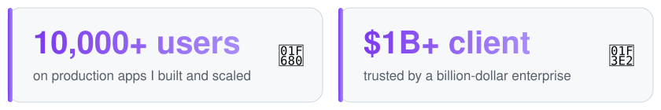

  

  <a href="https://git.io/typing-svg">
    <picture>
      <source media="(prefers-color-scheme: dark)" srcset="https://readme-typing-svg.demolab.com?font=JetBrains+Mono&amp;weight=600&amp;size=20&amp;pause=1200&amp;center=true&amp;vCenter=true&amp;color=93C5FD&amp;width=720&amp;lines=Founder+%26+Lead+Engineer+%40+TailoredTech;Building+production+apps+for+10%2C000%2B+users;Trusted+by+a+%241B%2B+enterprise+client;Solution+architect+%E2%80%94+offline-first%2C+secure%2C+business-first;Shipping+enterprise+logistics+%26+maritime+software;AI+%2F+ML+%E2%80%A2+Computer+Engineering+%40+AAST;Building+at+the+speed+of+thought+with+Cursor+%E2%9A%A1">
      
    </picture>
  </a>

  

  <picture>
    <source media="(prefers-color-scheme: dark)" srcset="./assets/highlights-dark.svg">
    
  </picture>

  
  
  
  

---

## 👋 About me

I'm **Abdelrahman Gasser**, founder and lead engineer at **[TailoredTech](https://www.tailoredtech.tech)** in Dubai (since 2024). I design and ship production software that scales to **10,000+ users**, and I've delivered for a **$1B+ enterprise client**.

> 🌐 **See what we build at [www.tailoredtech.tech](https://www.tailoredtech.tech)**

- 🚀 **Founder & Lead Engineer**: I take products from idea to production, from architecture through code to delivery.
- 📈 **Proven at scale**: apps I built serve **10,000+ users**, and a **$1B+ enterprise client** trusts us with its software.
- 🧠 **Solution architect**: offline-first sync, security by design and business-first thinking.
- 🚢 **Enterprise logistics & maritime software**: approval workflows, purchase modules and the integrations around them.
- 🤖 **AI / ML**: built **Dawini AI** (2023) and trained with the **IOAI 2025 UAE team** (NLP, computer vision, transformers).
- 🎓 **Computer Engineering @ AAST Alexandria**, graduating Jan 2027 insha Allah. My thesis is an AI opportunity prediction engine: a knowledge graph across freelancing platforms that predicts jobs before they're listed.
- ⚡ **AI-native builder**: a Cursor power user shipping at the speed of thought.
- 🤸 **Fun fact**: ex-competitive gymnast (international championship, 2019). I can still land a backflip and hold a one-minute handstand.

## 🛠️ Tech stack

  
   
  

      

## 📊 GitHub stats

  <picture>
  <source media="(prefers-color-scheme: dark)" srcset="https://github-readme-stats.vercel.app/api?username=abdelrahmangasser555&amp;show_icons=true&amp;disable_animations=true&amp;rank_icon=github&amp;theme=algolia&amp;hide_border=true&amp;bg_color=0d1117&amp;title_color=93C5FD&amp;icon_color=60A5FA&amp;text_color=c9d1d9">
  
</picture>
  <picture>
  <source media="(prefers-color-scheme: dark)" srcset="https://github-readme-stats.vercel.app/api/top-langs/?username=abdelrahmangasser555&amp;layout=compact&amp;langs_count=8&amp;disable_animations=true&amp;hide=jupyter%20notebook%2Chtml%2Ccss&amp;theme=algolia&amp;hide_border=true&amp;bg_color=0d1117&amp;title_color=93C5FD&amp;icon_color=60A5FA&amp;text_color=c9d1d9">
  
</picture>

  <picture>
  <source media="(prefers-color-scheme: dark)" srcset="https://streak-stats.demolab.com?user=abdelrahmangasser555&amp;hide_border=true&amp;disable_animations=true&amp;background=0d1117&amp;ring=60A5FA&amp;fire=D4AF37&amp;currStreakLabel=93C5FD&amp;sideLabels=c9d1d9&amp;currStreakNum=ffffff&amp;sideNums=ffffff&amp;dates=8b949e&amp;stroke=30363d">
  
</picture>

  

  <picture>
  <source media="(prefers-color-scheme: dark)" srcset="https://github-trophies.vercel.app/?username=abdelrahmangasser555&amp;no-frame=true&amp;no-bg=true&amp;column=7&amp;margin-w=8&amp;theme=algolia">
  
</picture>

## 🐍 Contribution snake

  <picture>
  <source media="(prefers-color-scheme: dark)" srcset="https://raw.githubusercontent.com/abdelrahmangasser555/abdelrahmangasser555/output/github-snake-dark.svg">
  
</picture>

## ⚡ Recent activity

<!--START_SECTION:activity-->
<!--END_SECTION:activity-->

---

<i>Building things that matter, one commit at a time. Let's build something great together 🤝</i>

  

